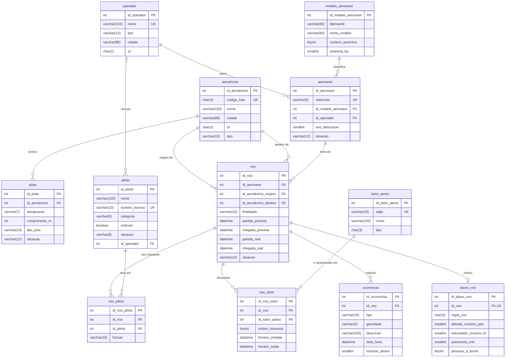

# Modelagem final do banco de dados

Documento do modelo lógico e físico do banco `trafego_aereo`. É a referência para os scripts SQL e para o relatório técnico. Tema: registro e análise de operações de tráfego aéreo na aviação geral, restrita a aeronaves leves monomotoras usadas em instrução, passeio, voo particular e traslado.

## 1. Visão geral

O modelo tem 12 tabelas. Todas usam chave primária `INT AUTO_INCREMENT` com nome `id_<tabela>`, motor `InnoDB` e charset `utf8mb4`. As colunas que representam domínios fechados (tipo, situação, finalidade, função) são `VARCHAR` com valores em minúsculas, sem acentos; nas mais importantes para as regras de negócio esses valores são garantidos por `CHECK ... IN (...)`, no mesmo estilo do Anexo II do enunciado. O modelo tem 10 restrições CHECK, número escolhido para que todas possam ser explicadas na apresentação; nas demais colunas de domínio fechado, os valores aceitos são documentados e respeitados na massa de dados. Horários usam `DATETIME`.

| N.º | Tabela | Papel no modelo |
|---|---|---|
| 1 | `aerodromo` | Aeródromos brasileiros reais (código ICAO) |
| 2 | `pista` | Pistas de cada aeródromo |
| 3 | `operador` | Aeroclubes, escolas de aviação e proprietários particulares |
| 4 | `modelo_aeronave` | Catálogo de modelos de aeronaves leves (fabricante, assentos, potência) |
| 5 | `aeronave` | Aeronaves individuais, identificadas pela matrícula |
| 6 | `piloto` | Pilotos, alunos e instrutores |
| 7 | `voo` | Operação aérea planejada ou realizada |
| 8 | `voo_piloto` | Associativa voo e piloto (N:N), com a função a bordo |
| 9 | `setor_aereo` | Setores do espaço aéreo (FIR, TMA, CTR, ATZ) |
| 10 | `voo_setor` | Associativa voo e setor (N:N), com horários de entrada e saída |
| 11 | `ocorrencia` | Ocorrências registradas em um voo |
| 12 | `plano_voo` | Plano de voo apresentado para um voo (1:1) |

Ordem de criação e de inserção (dependências): `aerodromo`, `pista`, `operador`, `modelo_aeronave`, `aeronave`, `piloto`, `setor_aereo`, `voo`, `voo_piloto`, `voo_setor`, `ocorrencia`, `plano_voo`.

## 2. Regras de negócio que orientam o modelo

Um aeródromo pode ter várias pistas, e cada pista pertence a um único aeródromo; a designação da pista (por exemplo, `09/27`) é única dentro do aeródromo, mas se repete entre aeródromos diferentes. Cada aeronave pertence a um operador e é de um único modelo; o fabricante, a quantidade de assentos e a potência são características do modelo, e não da matrícula. Cada piloto pode estar vinculado a um operador (o aeroclube ou a escola em que voa), mas a licença do piloto existe independentemente desse vínculo, por isso o vínculo é opcional.

Um voo é sempre executado por uma aeronave, parte de um aeródromo de origem e se destina a um aeródromo de destino. Na aviação geral não existe número de voo comercial; o voo é identificado pela aeronave e pelo horário de partida previsto, e a mesma aeronave não pode ter dois voos com a mesma partida prevista. Origem e destino podem ser o mesmo aeródromo: é o caso do circuito de tráfego e dos voos locais de instrução, que decolam e pousam no mesmo lugar. Por isso, ao contrário do que a proposta-base sugeria como possibilidade, o modelo não usa `CHECK (origem <> destino)`.

Um voo tem um ou mais pilotos a bordo, cada um com uma função (comandante, instrutor, aluno ou copiloto), e um piloto participa de muitos voos ao longo do tempo. Um voo atravessa um ou mais setores do espaço aéreo, em uma ordem, com horário de entrada e de saída em cada setor; um setor é atravessado por muitos voos. Um voo pode ter zero ou várias ocorrências (atraso, cancelamento, desvio, falha técnica, condição meteorológica, pouso alternativo). Um voo pode ter no máximo um plano de voo, e cada plano de voo se refere a exatamente um voo; voos locais de circuito de tráfego normalmente não têm plano registrado.

## 3. Definição das tabelas

Convenções nas tabelas abaixo: "NN" significa `NOT NULL`; "NULL" indica coluna que aceita ausência de valor. Os nomes das restrições seguem `fk_<tabela>_<referenciada>`, `ck_<tabela>_<coluna>` e `uq_<tabela>_<coluna>`; em UNIQUE compostos de associativas foi usado o sufixo `_par`.

### 3.1 `aerodromo`

| Coluna | Tipo | Nulo | Restrições |
|---|---|---|---|
| `id_aerodromo` | INT | NN | PK, AUTO_INCREMENT |
| `codigo_icao` | CHAR(4) | NN | `uq_aerodromo_codigo_icao` |
| `nome` | VARCHAR(120) | NN | |
| `cidade` | VARCHAR(80) | NN | |
| `uf` | CHAR(2) | NN | |
| `tipo` | VARCHAR(10) | NN | DEFAULT `'publico'`; valores aceitos (sem CHECK): (`'publico'`, `'privado'`) |

### 3.2 `pista`

| Coluna | Tipo | Nulo | Restrições |
|---|---|---|---|
| `id_pista` | INT | NN | PK, AUTO_INCREMENT |
| `id_aerodromo` | INT | NN | FK para `aerodromo`, `fk_pista_aerodromo` |
| `designacao` | VARCHAR(7) | NN | UNIQUE composto `uq_pista_aerodromo_designacao` (`id_aerodromo`, `designacao`) |
| `comprimento_m` | INT | NN | `ck_pista_comprimento_m` (`comprimento_m > 0`) |
| `tipo_piso` | VARCHAR(10) | NN | valores aceitos (sem CHECK): (`'asfalto'`, `'concreto'`, `'grama'`, `'terra'`, `'cascalho'`) |
| `situacao` | VARCHAR(12) | NN | DEFAULT `'ativa'`; valores aceitos (sem CHECK): (`'ativa'`, `'interditada'`, `'em_obras'`) |

### 3.3 `operador`

| Coluna | Tipo | Nulo | Restrições |
|---|---|---|---|
| `id_operador` | INT | NN | PK, AUTO_INCREMENT |
| `nome` | VARCHAR(120) | NN | `uq_operador_nome` |
| `tipo` | VARCHAR(12) | NN | valores aceitos (sem CHECK): (`'aeroclube'`, `'escola'`, `'particular'`) |
| `cidade` | VARCHAR(80) | NN | |
| `uf` | CHAR(2) | NN | |

### 3.4 `modelo_aeronave`

| Coluna | Tipo | Nulo | Restrições |
|---|---|---|---|
| `id_modelo_aeronave` | INT | NN | PK, AUTO_INCREMENT |
| `fabricante` | VARCHAR(60) | NN | |
| `nome_modelo` | VARCHAR(60) | NN | UNIQUE composto `uq_modelo_aeronave_fabricante_modelo` (`fabricante`, `nome_modelo`) |
| `numero_assentos` | TINYINT | NN | `ck_modelo_aeronave_numero_assentos` (`numero_assentos BETWEEN 1 AND 6`) |
| `potencia_hp` | SMALLINT | NN | valor positivo (sem CHECK) |

O limite de 6 assentos materializa o escopo de aeronaves leves e impede o cadastro acidental de aeronaves comerciais.

### 3.5 `aeronave`

| Coluna | Tipo | Nulo | Restrições |
|---|---|---|---|
| `id_aeronave` | INT | NN | PK, AUTO_INCREMENT |
| `matricula` | VARCHAR(6) | NN | `uq_aeronave_matricula` (formato `PP-XXX`, `PR-XXX`, `PS-XXX`, `PT-XXX`) |
| `id_modelo_aeronave` | INT | NN | FK para `modelo_aeronave`, `fk_aeronave_modelo_aeronave` |
| `id_operador` | INT | NN | FK para `operador`, `fk_aeronave_operador` |
| `ano_fabricacao` | SMALLINT | NN | entre 1940 e o ano corrente (sem CHECK) |
| `situacao` | VARCHAR(12) | NN | DEFAULT `'ativa'`; valores aceitos (sem CHECK): (`'ativa'`, `'manutencao'`, `'inativa'`) |

### 3.6 `piloto`

| Coluna | Tipo | Nulo | Restrições |
|---|---|---|---|
| `id_piloto` | INT | NN | PK, AUTO_INCREMENT |
| `nome` | VARCHAR(120) | NN | |
| `numero_licenca` | VARCHAR(10) | NN | `uq_piloto_numero_licenca` (código fictício de 6 dígitos, no estilo do código ANAC) |
| `categoria` | VARCHAR(6) | NN | valores aceitos (sem CHECK): (`'aluno'`, `'PP'`, `'PC'`) |
| `instrutor` | BOOLEAN | NN | DEFAULT `FALSE`; indica habilitação de instrutor de voo (INVA) |
| `situacao` | VARCHAR(8) | NN | DEFAULT `'ativo'`; valores aceitos (sem CHECK): (`'ativo'`, `'inativo'`) |
| `id_operador` | INT | NULL | FK para `operador`, `fk_piloto_operador` |

### 3.7 `setor_aereo`

| Coluna | Tipo | Nulo | Restrições |
|---|---|---|---|
| `id_setor_aereo` | INT | NN | PK, AUTO_INCREMENT |
| `sigla` | VARCHAR(20) | NN | `uq_setor_aereo_sigla` |
| `nome` | VARCHAR(120) | NN | |
| `tipo` | CHAR(3) | NN | valores aceitos (sem CHECK): (`'FIR'`, `'TMA'`, `'CTR'`, `'ATZ'`) |

### 3.8 `voo`

| Coluna | Tipo | Nulo | Restrições |
|---|---|---|---|
| `id_voo` | INT | NN | PK, AUTO_INCREMENT |
| `id_aeronave` | INT | NN | FK para `aeronave`, `fk_voo_aeronave` |
| `id_aerodromo_origem` | INT | NN | FK para `aerodromo`, `fk_voo_aerodromo_origem` |
| `id_aerodromo_destino` | INT | NN | FK para `aerodromo`, `fk_voo_aerodromo_destino` |
| `finalidade` | VARCHAR(10) | NN | `ck_voo_finalidade` IN (`'instrucao'`, `'passeio'`, `'particular'`, `'traslado'`) |
| `partida_prevista` | DATETIME | NN | UNIQUE composto `uq_voo_aeronave_partida` (`id_aeronave`, `partida_prevista`) |
| `chegada_prevista` | DATETIME | NN | `ck_voo_chegada_prevista` (`chegada_prevista > partida_prevista`) |
| `partida_real` | DATETIME | NULL | NULL quando o voo ainda não ocorreu ou foi cancelado |
| `chegada_real` | DATETIME | NULL | `ck_voo_chegada_real` (`chegada_real IS NULL OR partida_real IS NULL OR chegada_real > partida_real`) |
| `situacao` | VARCHAR(10) | NN | DEFAULT `'previsto'`; `ck_voo_situacao` IN (`'previsto'`, `'realizado'`, `'cancelado'`) |

### 3.9 `voo_piloto` (associativa)

| Coluna | Tipo | Nulo | Restrições |
|---|---|---|---|
| `id_voo_piloto` | INT | NN | PK, AUTO_INCREMENT |
| `id_voo` | INT | NN | FK para `voo`, `fk_voo_piloto_voo` |
| `id_piloto` | INT | NN | FK para `piloto`, `fk_voo_piloto_piloto` |
| `funcao` | VARCHAR(10) | NN | `ck_voo_piloto_funcao` IN (`'comandante'`, `'instrutor'`, `'aluno'`, `'copiloto'`) |

UNIQUE composto `uq_voo_piloto_par` (`id_voo`, `id_piloto`): o mesmo piloto não aparece duas vezes no mesmo voo.

### 3.10 `voo_setor` (associativa)

| Coluna | Tipo | Nulo | Restrições |
|---|---|---|---|
| `id_voo_setor` | INT | NN | PK, AUTO_INCREMENT |
| `id_voo` | INT | NN | FK para `voo`, `fk_voo_setor_voo` |
| `id_setor_aereo` | INT | NN | FK para `setor_aereo`, `fk_voo_setor_setor_aereo` |
| `ordem_travessia` | TINYINT | NN | 1, 2, 3... na ordem cronológica (sem CHECK) |
| `horario_entrada` | DATETIME | NN | |
| `horario_saida` | DATETIME | NN | `ck_voo_setor_horario_saida` (`horario_saida > horario_entrada`) |

UNIQUE compostos: `uq_voo_setor_par` (`id_voo`, `id_setor_aereo`), pois cada setor é registrado uma vez por voo, e `uq_voo_setor_ordem` (`id_voo`, `ordem_travessia`), pois duas travessias do mesmo voo não podem ter a mesma posição na sequência.

### 3.11 `ocorrencia`

| Coluna | Tipo | Nulo | Restrições |
|---|---|---|---|
| `id_ocorrencia` | INT | NN | PK, AUTO_INCREMENT |
| `id_voo` | INT | NN | FK para `voo`, `fk_ocorrencia_voo` |
| `tipo` | VARCHAR(25) | NN | valores aceitos (sem CHECK): (`'atraso'`, `'cancelamento'`, `'desvio'`, `'falha_tecnica'`, `'condicao_meteorologica'`, `'pouso_alternativo'`) |
| `gravidade` | VARCHAR(5) | NN | DEFAULT `'baixa'`; valores aceitos (sem CHECK): (`'baixa'`, `'media'`, `'alta'`) |
| `descricao` | VARCHAR(255) | NN | |
| `data_hora` | DATETIME | NN | |
| `minutos_atraso` | SMALLINT | NN | DEFAULT `0`; `ck_ocorrencia_minutos_atraso` (`minutos_atraso >= 0`) |

### 3.12 `plano_voo`

| Coluna | Tipo | Nulo | Restrições |
|---|---|---|---|
| `id_plano_voo` | INT | NN | PK, AUTO_INCREMENT |
| `id_voo` | INT | NN | FK para `voo`, `fk_plano_voo_voo`; `uq_plano_voo_id_voo` (garante o 1:1) |
| `regra_voo` | CHAR(3) | NN | DEFAULT `'VFR'`; `ck_plano_voo_regra_voo` IN (`'VFR'`, `'IFR'`) |
| `altitude_cruzeiro_pes` | SMALLINT | NN | entre 4.500 e 8.000 pés na massa de dados (sem CHECK) |
| `velocidade_cruzeiro_kt` | SMALLINT | NN | valor positivo (sem CHECK) |
| `autonomia_min` | SMALLINT | NN | valor positivo (sem CHECK) |
| `pessoas_a_bordo` | TINYINT | NN | pelo menos 1 (sem CHECK) |

## 4. Chaves estrangeiras e ações referenciais

Todas as chaves primárias são substitutas (`AUTO_INCREMENT`) e não têm significado de negócio, de modo que não se espera alterá-las. Mesmo assim, todas as FKs declaram `ON UPDATE CASCADE`, para que uma eventual correção de identificador se propague sem deixar órfãos. A ação de exclusão varia conforme a regra de negócio.

| Restrição | Tabela (coluna) | Referencia | ON DELETE | ON UPDATE |
|---|---|---|---|---|
| `fk_pista_aerodromo` | `pista` (`id_aerodromo`) | `aerodromo` | CASCADE | CASCADE |
| `fk_aeronave_modelo_aeronave` | `aeronave` (`id_modelo_aeronave`) | `modelo_aeronave` | RESTRICT | CASCADE |
| `fk_aeronave_operador` | `aeronave` (`id_operador`) | `operador` | RESTRICT | CASCADE |
| `fk_piloto_operador` | `piloto` (`id_operador`) | `operador` | SET NULL | CASCADE |
| `fk_voo_aeronave` | `voo` (`id_aeronave`) | `aeronave` | RESTRICT | CASCADE |
| `fk_voo_aerodromo_origem` | `voo` (`id_aerodromo_origem`) | `aerodromo` | RESTRICT | CASCADE |
| `fk_voo_aerodromo_destino` | `voo` (`id_aerodromo_destino`) | `aerodromo` | RESTRICT | CASCADE |
| `fk_voo_piloto_voo` | `voo_piloto` (`id_voo`) | `voo` | CASCADE | CASCADE |
| `fk_voo_piloto_piloto` | `voo_piloto` (`id_piloto`) | `piloto` | RESTRICT | CASCADE |
| `fk_voo_setor_voo` | `voo_setor` (`id_voo`) | `voo` | CASCADE | CASCADE |
| `fk_voo_setor_setor_aereo` | `voo_setor` (`id_setor_aereo`) | `setor_aereo` | RESTRICT | CASCADE |
| `fk_ocorrencia_voo` | `ocorrencia` (`id_voo`) | `voo` | RESTRICT | CASCADE |
| `fk_plano_voo_voo` | `plano_voo` (`id_voo`) | `voo` | CASCADE | CASCADE |

Justificativas. A pista é parte do aeródromo e não tem sentido sem ele, por isso é removida junto (CASCADE); na prática, um aeródromo que já tenha voos não pode ser excluído, porque as FKs de origem e destino em `voo` são RESTRICT, e essa proteção prevalece. Modelos de aeronave e operadores não podem ser excluídos enquanto houver aeronaves que dependam deles (RESTRICT), pois isso deixaria aeronaves sem modelo ou sem responsável. O vínculo do piloto com o operador é opcional: se um aeroclube for excluído do cadastro, o piloto continua existindo com sua licença e apenas perde o vínculo (SET NULL), o que exige que `piloto.id_operador` aceite NULL.

O voo é registro histórico de operação: aeronaves e aeródromos com voos registrados não podem ser apagados (RESTRICT). A tripulação (`voo_piloto`), as travessias de setor (`voo_setor`) e o plano de voo (`plano_voo`) são detalhes do próprio voo e não têm significado isolado, por isso são removidos junto com ele (CASCADE). Já um piloto ou um setor que apareça em algum voo não pode ser excluído (RESTRICT), para não apagar o histórico de quem voou e por onde. As ocorrências são registros de segurança operacional e não devem desaparecer silenciosamente: a exclusão de um voo com ocorrências é bloqueada (RESTRICT) e exige que a ocorrência seja tratada antes.

## 5. Resumo das restrições exigidas

O modelo tem 10 restrições CHECK, em 10 colunas distintas (mínimo exigido: 3), uma por coluna:

| N.º | Restrição | Coluna | Regra |
|---|---|---|---|
| 1 | `ck_pista_comprimento_m` | `pista.comprimento_m` | `comprimento_m > 0` |
| 2 | `ck_modelo_aeronave_numero_assentos` | `modelo_aeronave.numero_assentos` | `BETWEEN 1 AND 6` (escopo de aeronaves leves) |
| 3 | `ck_voo_finalidade` | `voo.finalidade` | `IN ('instrucao', 'passeio', 'particular', 'traslado')` |
| 4 | `ck_voo_situacao` | `voo.situacao` | `IN ('previsto', 'realizado', 'cancelado')` |
| 5 | `ck_voo_chegada_prevista` | `voo.chegada_prevista` | `chegada_prevista > partida_prevista` |
| 6 | `ck_voo_chegada_real` | `voo.chegada_real` | `chegada_real IS NULL OR partida_real IS NULL OR chegada_real > partida_real` |
| 7 | `ck_voo_piloto_funcao` | `voo_piloto.funcao` | `IN ('comandante', 'instrutor', 'aluno', 'copiloto')` |
| 8 | `ck_voo_setor_horario_saida` | `voo_setor.horario_saida` | `horario_saida > horario_entrada` |
| 9 | `ck_ocorrencia_minutos_atraso` | `ocorrencia.minutos_atraso` | `minutos_atraso >= 0` |
| 10 | `ck_plano_voo_regra_voo` | `plano_voo.regra_voo` | `IN ('VFR', 'IFR')` |

A escolha cobre os três estilos de regra que o enunciado exemplifica: faixa numérica (1, 2 e 9), lista de valores com `IN` (3, 4, 7 e 10) e comparação entre duas colunas da mesma linha (5, 6 e 8). Os CHECK 9 e 10 acompanham colunas com DEFAULT, o que permite mostrar as duas restrições juntas na apresentação.

DEFAULT aparece em 9 colunas, acima do mínimo de 2: `aerodromo.tipo` (`'publico'`), `pista.situacao` (`'ativa'`), `aeronave.situacao` (`'ativa'`), `piloto.instrutor` (`FALSE`), `piloto.situacao` (`'ativo'`), `voo.situacao` (`'previsto'`), `ocorrencia.gravidade` (`'baixa'`), `ocorrencia.minutos_atraso` (`0`) e `plano_voo.regra_voo` (`'VFR'`). São 9 colunas em 7 tabelas distintas.

UNIQUE simples: `aerodromo.codigo_icao`, `operador.nome`, `aeronave.matricula`, `piloto.numero_licenca`, `setor_aereo.sigla`, `plano_voo.id_voo`. UNIQUE compostos: `pista` (`id_aerodromo`, `designacao`), `modelo_aeronave` (`fabricante`, `nome_modelo`), `voo` (`id_aeronave`, `partida_prevista`), `voo_piloto` (`id_voo`, `id_piloto`), `voo_setor` (`id_voo`, `id_setor_aereo`) e `voo_setor` (`id_voo`, `ordem_travessia`).

NOT NULL: todas as colunas são NOT NULL, exceto `piloto.id_operador`, `voo.partida_real` e `voo.chegada_real`, cuja ausência tem significado de negócio (piloto sem vínculo; voo ainda não realizado ou cancelado).

## 6. Cardinalidades

| Relacionamento | Tipo | Implementação |
|---|---|---|
| `aerodromo` - `pista` | 1:N | FK `pista.id_aerodromo` |
| `operador` - `aeronave` | 1:N | FK `aeronave.id_operador` |
| `modelo_aeronave` - `aeronave` | 1:N | FK `aeronave.id_modelo_aeronave` |
| `operador` - `piloto` | 1:N (opcional do lado do piloto) | FK anulável `piloto.id_operador` |
| `aeronave` - `voo` | 1:N | FK `voo.id_aeronave` |
| `aerodromo` - `voo` (origem) | 1:N | FK `voo.id_aerodromo_origem` |
| `aerodromo` - `voo` (destino) | 1:N | FK `voo.id_aerodromo_destino` |
| `voo` - `ocorrencia` | 1:N | FK `ocorrencia.id_voo` |
| `voo` - `piloto` | N:N | associativa `voo_piloto` |
| `voo` - `setor_aereo` | N:N | associativa `voo_setor` |
| `voo` - `plano_voo` | 1:1 | FK `plano_voo.id_voo` com UNIQUE |

Confirmação dos mínimos do enunciado: 12 tabelas, todas ligadas ao grafo de relacionamentos (mínimo 8); 2 relacionamentos N:N por tabela associativa (mínimo 2); 8 relacionamentos 1:N por chave estrangeira direta, sem contar os quatro 1:N que compõem as associativas (mínimo 4); 1 relacionamento 1:1. O 1:1 é opcional do lado do voo (nem todo voo tem plano), e obrigatório do lado do plano (todo plano pertence a exatamente um voo, garantido por `NOT NULL` e `UNIQUE` em `plano_voo.id_voo`).

## 7. Normalização

### 7.1 Verificação por tabela

Primeira forma normal. Todas as colunas guardam valores atômicos e não há grupos repetitivos. Os casos em que um voo teria vários valores do mesmo tipo (vários pilotos, vários setores, várias ocorrências) foram modelados como linhas em tabelas próprias, e não como listas ou colunas numeradas (`piloto1`, `piloto2`). A designação da pista (`09/27`) é tratada como um único valor, pois é assim que a pista é identificada operacionalmente: as duas cabeceiras são a mesma pista física.

Segunda forma normal. Todas as tabelas têm chave primária simples (`id_<tabela>`), portanto não pode existir dependência parcial de parte da chave. O ponto que merece atenção são as associativas, cujas chaves candidatas naturais são compostas. Em `voo_piloto`, a chave candidata é (`id_voo`, `id_piloto`) e a única coluna não chave, `funcao`, depende do par inteiro: o mesmo piloto é instrutor em um voo e comandante em outro. Em `voo_setor`, a chave candidata é (`id_voo`, `id_setor_aereo`), e `ordem_travessia`, `horario_entrada` e `horario_saida` também dependem do par inteiro, e não só do voo ou só do setor. Nenhum dado do voo (como a aeronave) ou do setor (como o nome) foi repetido nessas tabelas.

Terceira forma normal. Em cada tabela, as colunas não chave dependem apenas da chave. A análise tabela por tabela é a seguinte. Em `aerodromo`, nome, cidade, UF e tipo dependem do aeródromo; o código ICAO é chave candidata, não um determinante externo. Em `pista`, comprimento, piso e situação dependem da pista. Em `operador`, tipo, cidade e UF dependem do operador. Em `modelo_aeronave`, fabricante, assentos e potência dependem do modelo. Em `aeronave`, restam apenas atributos da unidade física (matrícula, ano, situação) e as FKs para modelo e operador. Em `piloto`, categoria, habilitação de instrutor e situação dependem do piloto. Em `setor_aereo`, nome e tipo dependem do setor. Em `voo`, aeronave, origem, destino, finalidade, horários e situação dependem do voo; o operador do voo não é guardado em `voo`, porque é obtido pela aeronave, o que evitaria a dependência transitiva voo, aeronave, operador. Em `ocorrencia` e `plano_voo`, todos os atributos descrevem a própria ocorrência ou o próprio plano.

Dois pontos foram analisados e mantidos de propósito. Em `aerodromo` e `operador`, a dupla cidade e UF não caracteriza dependência transitiva, porque o nome da cidade não determina a UF (há municípios homônimos em estados diferentes); extrair uma tabela de municípios seria correto em um sistema maior, mas acrescentaria uma tabela sem ganho para as consultas do projeto. Em `ocorrencia`, a coluna `minutos_atraso` não é derivada dos horários do voo: ela registra o atraso atribuído àquela ocorrência específica, enquanto o atraso total do voo é calculado por `partida_real - partida_prevista`. Um voo pode ter duas ocorrências que, juntas, explicam o atraso, ou uma ocorrência sem atraso algum.

### 7.2 Exemplo principal de decomposição: extração de `modelo_aeronave`

Na proposta-base, a tabela de aeronaves guardava o modelo e o número de assentos junto com a matrícula. Antes da decomposição, a tabela teria a forma abaixo (quatro aeronaves reais da massa de dados: três Cessna 172 Skyhawk e um Tecnam P2008 JC).

| id_aeronave | matricula | fabricante | modelo | numero_assentos | potencia_hp | ano_fabricacao | id_operador |
|---|---|---|---|---|---|---|---|
| 1 | PR-EKA | Cessna | 172 Skyhawk | 4 | 180 | 2008 | 1 |
| 2 | PT-OJB | Cessna | 172 Skyhawk | 4 | 180 | 1998 | 1 |
| 7 | PR-JDA | Cessna | 172 Skyhawk | 4 | 180 | 2012 | 3 |
| 15 | PS-RCA | Tecnam | P2008 JC | 2 | 100 | 2021 | 8 |

A chave é `id_aeronave` (e, como chave candidata, `matricula`). Existem as dependências funcionais `id_aeronave -> modelo` e `modelo -> fabricante, numero_assentos, potencia_hp`. Logo, fabricante, assentos e potência dependem da aeronave apenas de forma transitiva, por meio do modelo, o que viola a 3FN. As consequências são as anomalias clássicas: os dados do Cessna 172 se repetem em cada matrícula (redundância); corrigir a potência do modelo exige alterar várias linhas, com risco de deixar valores divergentes (anomalia de atualização); não é possível cadastrar um modelo antes de existir uma aeronave dele (anomalia de inserção); e, ao excluir a última aeronave de um modelo, as informações do modelo desaparecem (anomalia de exclusão).

Depois da decomposição, os atributos que dependem do modelo passam para `modelo_aeronave`, e `aeronave` guarda apenas a FK.

`modelo_aeronave`

| id_modelo_aeronave | fabricante | nome_modelo | numero_assentos | potencia_hp |
|---|---|---|---|---|
| 3 | Cessna | 172 Skyhawk | 4 | 180 |
| 9 | Tecnam | P2008 JC | 2 | 100 |

`aeronave`

| id_aeronave | matricula | id_modelo_aeronave | ano_fabricacao | id_operador |
|---|---|---|---|---|
| 1 | PR-EKA | 3 | 2008 | 1 |
| 2 | PT-OJB | 3 | 1998 | 1 |
| 7 | PR-JDA | 3 | 2012 | 3 |
| 15 | PS-RCA | 9 | 2021 | 8 |

Cada fato passa a ser registrado uma única vez, e a junção `aeronave` com `modelo_aeronave` pela FK reconstrói a tabela original sem perda de informação. O `ano_fabricacao` permanece em `aeronave`, porque depende da unidade física (matrícula), e não do modelo.

### 7.3 Exemplo complementar (1FN): pilotos do voo

Um registro ingênuo de voo poderia guardar a tripulação em uma coluna de texto, como `pilotos = 'Fulano (instrutor), Beltrano (aluno)'`, ou em colunas `piloto1`, `piloto2`. Isso viola a 1FN (valor não atômico ou grupo repetitivo) e impede contar voos por piloto de forma confiável. A solução adotada é a associativa `voo_piloto`, com uma linha por piloto em cada voo e a função a bordo como atributo do relacionamento.

## 8. Diagrama entidade-relacionamento

Fonte Mermaid (renderizada automaticamente pelo GitHub). Notação: `PK` chave primária, `FK` chave estrangeira, `UK` coluna com UNIQUE simples. Os UNIQUE compostos estão descritos na seção 3. As cardinalidades refletem o esquema físico: o lado "muitos" é sempre opcional (`o{`), porque o banco não obriga, por exemplo, que um voo tenha piloto; a regra de que todo voo realizado tem ao menos um piloto é garantida pelos dados (seção 10). A linha `operador |o--o{ piloto` indica que o piloto pode não ter operador.

Exportação da imagem. O renderizador `mmdc` (Mermaid CLI) não está instalado neste ambiente, por isso `docs/img/der.png` ainda não foi gerado. Para exportar, use a fonte já salva em `docs/img/der.mmd` (idêntica ao bloco acima) e execute `npx -p @mermaid-js/mermaid-cli mmdc -i docs/img/der.mmd -o docs/img/der.png -w 2400 -b white`, ou cole a fonte em https://mermaid.live e use a opção de exportar PNG. No GitHub, o bloco Mermaid já é exibido como diagrama.

## 9. Regras de consistência dos dados

Algumas regras envolvem mais de uma tabela ou dependem do estado do voo e, por isso, não podem ser expressas em CHECK no MySQL (CHECK só enxerga a própria linha e não aceita subconsultas). Elas viram CHECK quando possível e, nos demais casos, devem ser respeitadas na massa de dados.

Viram CHECK: chegada prevista posterior à partida prevista (`ck_voo_chegada_prevista`); chegada real posterior à partida real quando ambas existem (`ck_voo_chegada_real`); saída do setor posterior à entrada (`ck_voo_setor_horario_saida`); minutos de atraso não negativos (`ck_ocorrencia_minutos_atraso`). As colunas de domínio fechado sem CHECK (seção 3) devem receber apenas os valores aceitos ali listados, e os valores numéricos sem CHECK (potência, ano de fabricação, ordem de travessia, altitude, velocidade, autonomia, pessoas a bordo) devem ser positivos e realistas.

Ficam como regra dos dados:

1. Voo `realizado` tem `partida_real` e `chegada_real` preenchidas; voo `previsto` ou `cancelado` tem as duas NULL.
2. A partida real fica próxima da prevista (adiantamento de até 10 minutos ou atraso de até 90 minutos); quando o atraso passar de 15 minutos, deve existir uma ocorrência do tipo `atraso`, `condicao_meteorologica` ou `falha_tecnica` com `minutos_atraso` coerente.
3. A duração do voo é coerente com a distância: circuito de tráfego e voo local de instrução de 40 a 90 minutos; navegação entre aeródromos próximos de 1 a 3 horas para monomotores a cerca de 90 a 120 nós.
4. Em `voo_setor`, `horario_entrada >= voo.partida_real` e `horario_saida <= voo.chegada_real`; as travessias do mesmo voo seguem a ordem cronológica de `ordem_travessia`, sem sobreposição (a entrada de um setor é igual ou posterior à saída do anterior). Só voos realizados têm linhas em `voo_setor`.
5. A mesma aeronave não tem dois voos com intervalos de tempo sobrepostos; o mesmo piloto também não.
6. Voo de finalidade `instrucao` tem um piloto com função `instrutor` (que precisa ter `instrutor = TRUE`) e normalmente um piloto com função `aluno` (categoria `aluno` ou `PP` em formação para PC). Voo de passeio, particular ou traslado tem um `comandante` (categoria `PP` ou `PC`) e, eventualmente, um `copiloto`. Piloto `inativo` não aparece em voos posteriores à sua inativação.
7. Voo `cancelado` tem uma ocorrência do tipo `cancelamento` com `data_hora` anterior ou igual à partida prevista.
8. A `data_hora` da ocorrência de voo realizado fica entre a partida prevista e a chegada real.
9. `plano_voo.pessoas_a_bordo` não excede `modelo_aeronave.numero_assentos` da aeronave do voo; `autonomia_min` é maior que a duração prevista do voo (com margem de pelo menos 30 minutos).
10. Plano IFR apenas para aeronaves e pilotos compatíveis (por exemplo, Cessna 172 ou Piper PA-28 com piloto PC); a maioria dos planos é VFR, com altitudes de cruzeiro entre 4.500 e 8.000 pés.
11. Aeronave em `manutencao` ou `inativa` não tem voos `previsto`.

## 10. Volume e distribuição dos dados

Todas as tabelas têm no mínimo 15 linhas. A massa de dados se concentra em Minas Gerais: a maior parte dos aeródromos, operadores e setores é mineira, com alguns aeródromos de São Paulo, Rio de Janeiro e Goiás como destinos de navegação. Os voos vão de setembro a novembro de 2026; os voos `previsto` estão datados a partir de 18/11/2026.

| Tabela | Linhas | Distribuição |
|---|---|---|
| `aerodromo` | 20 | Aeródromos reais com código ICAO: 15 de MG (ex.: SBBH Pampulha, SBCF Confins, SBUL Uberlândia, SBJF Juiz de Fora, SBMK Montes Claros, SNDV Divinópolis, SNPD Patos de Minas), 2 de SP (SBMT, SBRP), 2 do RJ (SBJR, SBRJ) e 1 de GO (SBGO). Todos públicos. Seis aeródromos não aparecem em nenhum voo, o que permite consultas com LEFT JOIN. Os códigos ICAO foram escolhidos entre aeródromos reais e devem ser conferidos no AISWEB/DECEA. |
| `pista` | 21 | Dezenove aeródromos com 1 pista e um (SBRJ) com 2 pistas paralelas (02L/20R e 02R/20L); todas de asfalto; 18 `ativa`, 2 `em_obras` e 1 `interditada`. |
| `operador` | 16 | 7 aeroclubes, 5 escolas de aviação e 4 particulares (pessoas físicas e empresas), com nomes fictícios; 14 sediados em MG, 1 em GO e 1 no RJ. |
| `modelo_aeronave` | 15 | Somente monomotores leves: Cessna 150, 152, 172 Skyhawk e 182 Skylane; Piper PA-18 Super Cub, PA-28-161 Warrior, PA-28-181 Archer e PA-38 Tomahawk; Tecnam P2008 JC e P2002 Sierra; CAP-4 Paulistinha; Neiva P-56 Paulistinha; Aero Boero AB-115; Embraer EMB-712 Tupi; Cirrus SR20. Dois modelos não têm aeronave cadastrada. |
| `aeronave` | 24 | O Cessna 172 Skyhawk é o modelo mais frequente (7 aeronaves), seguido do Cessna 152 (3); aeroclubes com 1 a 3 aeronaves, escolas com 1 ou 2 e particulares com 1; anos de fabricação de 1946 a 2022; 21 `ativa`, 2 em `manutencao` e 1 `inativa`; cinco aeronaves sem voos. Matrículas fictícias nos prefixos `PP-`, `PR-`, `PS-` e `PT-`. |
| `piloto` | 26 | 7 instrutores (`PC`, `instrutor = TRUE`), 9 alunos, 6 `PP` e os demais `PC`; 2 `inativo`; 2 sem operador. Nomes e licenças fictícios. Dois pilotos não aparecem em voos. |
| `setor_aereo` | 18 | Designações do espaço aéreo brasileiro: FIR Brasília e FIR Curitiba; TMA Belo Horizonte, São Paulo, Rio de Janeiro e Brasília; CTR Pampulha, Confins, Uberlândia, Goiânia e Jacarepaguá; ATZ de aeródromos mineiros (Uberaba, Montes Claros, Juiz de Fora, Varginha, Ipatinga, Governador Valadares) e ATZ Campo de Marte. As siglas devem ser conferidas nas publicações do DECEA (AIP Brasil). |
| `voo` | 39 | 30 `realizado`, 5 `previsto` e 4 `cancelado`; finalidade majoritariamente `instrucao` (22 voos), depois `particular` (10), `traslado` (4) e `passeio` (3); 15 voos locais com origem igual ao destino; SBBH é a origem mais frequente (13 partidas). |
| `voo_piloto` | 63 | 24 voos com 2 pilotos (22 de instrução, com instrutor e aluno, e 2 com comandante e copiloto) e 15 voos com 1 comandante; todo voo tem pelo menos um piloto; os instrutores mais ativos aparecem em 6 e 7 voos, outros pilotos em apenas 1. |
| `voo_setor` | 83 | Somente os 30 voos realizados; os 8 voos locais realizados têm 1 setor (CTR ou ATZ do aeródromo); as navegações têm de 2 a 5 setores. Os setores mais atravessados são FIR Brasília (22 passagens), CTR Pampulha (15) e TMA Belo Horizonte (12); vários setores têm só 1 ou 2 passagens e quatro (TMA-BR, CTR-SBCF, ATZ-SBGV e FIR-SBCW) não são atravessados por nenhum voo. |
| `ocorrencia` | 18 | Concentradas em 13 voos: 9 com 1 ocorrência, 3 com 2 e 1 com 3; a maioria dos voos não tem ocorrência; os 4 voos cancelados têm ocorrência de `cancelamento`; predominam `condicao_meteorologica` (5) e `atraso` (4); gravidade 13 `baixa`, 4 `media` e 1 `alta`. |
| `plano_voo` | 24 | Um plano para cada voo de navegação (origem diferente do destino); voos locais não têm plano; 21 `VFR` e 3 `IFR`; altitudes de cruzeiro de 4.500 a 8.000 pés. |

## 11. Decisões tomadas

As decisões que estavam em aberto foram decididas pela dupla, com as escolhas propostas.

1. A tabela `modelo_aeronave` foi extraída de `aeronave` e é o exemplo principal de decomposição para a 3FN.
2. O vínculo do piloto com o operador é opcional: `piloto.id_operador` aceita NULL e usa ON DELETE SET NULL.
3. Um voo com ocorrências não pode ser excluído (RESTRICT em `fk_ocorrencia_voo`), enquanto tripulação, setores e plano de voo são excluídos em cascata.
4. Cada setor é registrado uma única vez por voo (`uq_voo_setor_par`); a reentrada no mesmo setor fica fora do escopo.
5. Cidade e UF permanecem como texto em `aerodromo` e `operador`, sem tabela de municípios.
6. A coerência entre `voo.situacao` e o preenchimento dos horários reais é regra dos dados (seção 9, item 1), sem CHECK de várias colunas.
7. O número de restrições CHECK foi reduzido para 10 (seção 5), para facilitar a explicação oral.

Pendência: a exportação de `docs/img/der.png` depende de um renderizador Mermaid (instruções na seção 8); a fonte está em `docs/img/der.mmd`.
