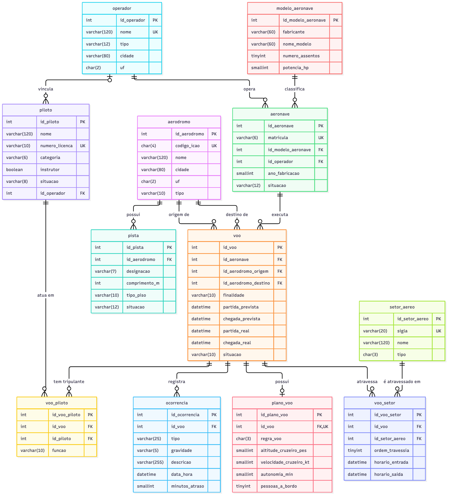
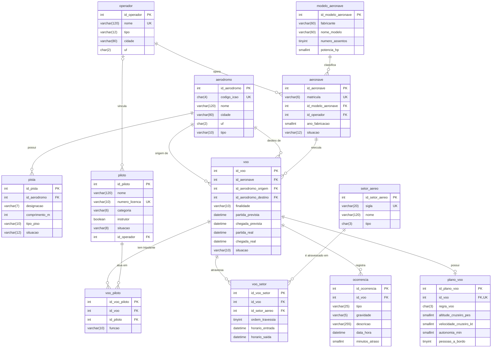

# Relatório técnico do Projeto Final de Banco de Dados

## 1 Capa e identificação

AFYA CENTRO UNIVERSITÁRIO

Curso de Engenharia da Computação

Disciplina: Banco de Dados

6º período

2º semestre de 2026

**SISTEMA DE REGISTRO E ANÁLISE DE OPERAÇÕES DE TRÁFEGO AÉREO NA AVIAÇÃO GERAL**

Projeto final da disciplina: modelagem, implementação e análise de banco de dados relacional em MySQL

Integrantes: Pedro Henrique Cardoso Maia e Daniel Lemos Pinheiro Barbosa

Professor: Evandro José de Oliveira Junior

Data de entrega: 16/11/2026

2026

## 2 Resumo executivo

Este trabalho apresenta o projeto e a implementação de um banco de dados relacional, denominado `trafego_aereo`, destinado ao registro e à análise de operações de tráfego aéreo na aviação geral, com escopo restrito a aeronaves leves monomotoras utilizadas em instrução, passeio, voo particular e traslado, e com dados centrados em Minas Gerais. O banco reúne aeródromos brasileiros reais e suas pistas, operadores (aeroclubes, escolas de aviação e proprietários particulares), modelos de aeronave, aeronaves, pilotos e instrutores, setores do espaço aéreo, voos, a tripulação de cada voo, as travessias de setores, as ocorrências e os planos de voo. A finalidade é permitir que um aeroclube ou uma escola de aviação consulte quais voos foram realizados, por quem, com qual aeronave, por quais setores passaram e quais ocorrências e atrasos afetaram a operação.

O esquema foi implementado em SQL puro no MySQL 8.0, com 12 tabelas normalizadas até a terceira forma normal, relacionamentos 1:1, 1:N e N:N, chaves primárias `INT AUTO_INCREMENT`, chaves estrangeiras com ações referenciais explícitas e restrições NOT NULL, UNIQUE, CHECK e DEFAULT. A massa de dados, inserida por `INSERT INTO`, totaliza 367 registros, com no mínimo 15 por tabela, e serve de base para as 12 consultas de análise apresentadas no catálogo deste relatório, que incluem agregações, junções entre até três tabelas, uma subconsulta e um LEFT JOIN.

## 3 Domínio e regras de negócio

O cenário modelado é o da aviação geral de pequeno porte, em que aeroclubes, escolas de aviação e proprietários particulares operam aeronaves leves a partir de aeródromos regionais. O recorte geográfico privilegia Minas Gerais: os aeroclubes e as escolas de aviação cadastrados são, em sua maioria, mineiros, e os voos partem principalmente de aeródromos do estado, com navegações e traslados eventuais para São Paulo, Rio de Janeiro e Goiás. O tema se inspira no acompanhamento da demanda de tráfego aéreo realizado pelo Departamento de Controle do Espaço Aéreo (DECEA), mas trata apenas do registro de operações planejadas e realizadas; o acompanhamento por radar em tempo real, o cálculo de trajetórias e a prevenção automática de colisões ficam fora do escopo. A aviação comercial e a de carga também foram excluídas, por decisão da dupla, para manter o domínio coerente e o volume de regras compatível com a disciplina.

O aeródromo é o ponto de partida do modelo. Cada aeródromo é identificado por um código ICAO de quatro letras, único no cadastro, e possui uma ou mais pistas; cada pista pertence a um único aeródromo, e sua designação (por exemplo, 09/27) não se repete dentro do mesmo aeródromo, embora possa se repetir entre aeródromos diferentes. A pista registra comprimento, tipo de piso e situação operacional, que por padrão é ativa. Os operadores são as entidades responsáveis pelas aeronaves e às quais os pilotos se vinculam. Cada aeronave é identificada pela matrícula do Registro Aeronáutico Brasileiro, pertence a um único operador e é de um único modelo; o fabricante, a quantidade de assentos e a potência do motor são características do modelo, e não da aeronave individual. O número de assentos de um modelo é limitado a seis, o que materializa no banco a restrição do escopo a aeronaves leves.

Os pilotos são cadastrados com nome, número de licença único, categoria (aluno piloto, piloto privado ou piloto comercial), indicação de habilitação de instrutor e situação. O vínculo do piloto com um operador é opcional, porque a licença existe independentemente do aeroclube ou da escola em que o piloto voa. Os setores do espaço aéreo, classificados como região de informação de voo (FIR), área de controle terminal (TMA), zona de controle (CTR) ou zona de tráfego de aeródromo (ATZ), são identificados por uma sigla única.

O voo é a entidade central. Como a aviação geral não utiliza número de voo comercial, cada voo é identificado pela aeronave e pelo horário de partida previsto, e a mesma aeronave não pode ter dois voos com a mesma partida prevista. Todo voo tem um aeródromo de origem e um de destino, que podem coincidir no caso de circuitos de tráfego e voos locais de instrução, uma finalidade (instrução, passeio, particular ou traslado), horários previstos e, quando realizado, horários reais, além de uma situação que por padrão é prevista e pode passar a realizada ou cancelada. A chegada deve ser posterior à partida, tanto nos horários previstos quanto nos reais.

Um voo tem um ou mais pilotos a bordo, cada um com uma função naquele voo (comandante, instrutor, aluno ou copiloto), e o mesmo piloto participa de muitos voos ao longo do tempo, o que caracteriza um relacionamento N:N. Da mesma forma, um voo atravessa um ou mais setores do espaço aéreo, em uma ordem definida e com horários de entrada e saída em cada um, e cada setor é atravessado por muitos voos. Um voo pode ter zero ou várias ocorrências, como atraso, cancelamento, desvio, falha técnica, condição meteorológica adversa ou pouso em aeródromo alternativo, cada uma com gravidade e minutos de atraso atribuídos, que por padrão são zero. Por fim, um voo pode ter no máximo um plano de voo, e cada plano pertence a exatamente um voo, com regras de voo (VFR por padrão, ou IFR), altitude e velocidade de cruzeiro, autonomia e número de pessoas a bordo.

As regras de exclusão refletem o caráter histórico dos registros. Aeronaves, aeródromos, pilotos e setores que aparecem em voos não podem ser excluídos, assim como um voo que tenha ocorrências registradas, pois estas são informações de segurança operacional. A tripulação, as travessias de setor e o plano de voo, por outro lado, são detalhes do próprio voo e são removidos junto com ele. Se um operador for excluído, os pilotos vinculados permanecem no cadastro e apenas perdem o vínculo. Algumas regras envolvem mais de uma tabela, como a exigência de que as travessias de setor ocorram dentro do intervalo real do voo, e não podem ser expressas por CHECK no MySQL; essas regras foram respeitadas na massa de dados e estão descritas em `docs/modelagem.md`.

A massa de dados cobre voos com partida prevista entre 2 de setembro e 22 de novembro de 2026 e contém 39 voos, dos quais 30 realizados, 4 cancelados e 5 previstos. Por finalidade, são 22 voos de instrução, 10 particulares, 4 traslados e 3 de passeio, e 15 voos são circuitos locais, com origem igual ao destino. Dos 20 aeródromos cadastrados, todos reais, 15 ficam em Minas Gerais, 2 em São Paulo, 2 no Rio de Janeiro e 1 em Goiás; dos 16 operadores, 14 têm sede em Minas Gerais, 1 em Goiás e 1 no Rio de Janeiro. Os operadores, as aeronaves, as matrículas, os pilotos e as licenças são fictícios, embora plausíveis, e nenhum dado pessoal real foi utilizado.

## 4 Diagrama entidade-relacionamento

A Figura 1 apresenta o diagrama entidade-relacionamento do esquema físico. Na notação utilizada, PK indica chave primária, FK indica chave estrangeira e UK indica coluna com restrição UNIQUE simples; as restrições UNIQUE compostas estão descritas no dicionário de dados (seção 5). Nas extremidades das linhas de relacionamento, `||` representa exatamente um, `|o` e `o|` representam zero ou um e `o{` representa zero ou muitos. Os relacionamentos N:N entre voo e piloto e entre voo e setor aéreo aparecem decompostos nas tabelas associativas `voo_piloto` e `voo_setor`; o relacionamento 1:1 entre voo e plano de voo é garantido pela restrição UNIQUE em `plano_voo.id_voo`; a linha entre operador e piloto indica que o piloto pode não ter operador.

Figura 1 – Diagrama entidade-relacionamento do banco `trafego_aereo`



Fonte: elaborado pelos autores.

A fonte do diagrama em Mermaid, a partir da qual a Figura 1 foi gerada, é reproduzida a seguir e também está disponível em `docs/img/der.mmd`; o GitHub a exibe diretamente como diagrama.



## 5 Dicionário de dados

O banco `trafego_aereo` foi criado no MySQL 8.0, com motor InnoDB e conjunto de caracteres utf8mb4. Todas as chaves primárias são do tipo `INT AUTO_INCREMENT`, e todas as chaves estrangeiras declaram `ON UPDATE CASCADE`; a ação `ON DELETE` de cada uma está indicada na coluna de restrições. Nas tabelas a seguir são usadas as abreviações PK (chave primária), FK (chave estrangeira), NN (NOT NULL), UQ (UNIQUE), CK (CHECK) e DF (DEFAULT). O banco tem 10 restrições CHECK; nas colunas marcadas "sem CHECK", os valores aceitos são regra de negócio respeitada na massa de dados, sem restrição declarada no DDL. O mesmo conteúdo está disponível em `docs/dicionario_de_dados.md`.

Aeródromos brasileiros (públicos ou privados) onde os voos partem ou pousam.

Tabela 1 – `aerodromo`

| Campo | Tipo | Restrições | Descrição |
|---|---|---|---|
| `id_aerodromo` | INT | PK, AUTO_INCREMENT | Identificador do aeródromo |
| `codigo_icao` | CHAR(4) | NN, UQ | Código ICAO de quatro letras (ex.: SBBH) |
| `nome` | VARCHAR(120) | NN | Nome oficial do aeródromo |
| `cidade` | VARCHAR(80) | NN | Município onde o aeródromo está localizado |
| `uf` | CHAR(2) | NN | Sigla da unidade da federação |
| `tipo` | VARCHAR(10) | NN, DF 'publico', valores aceitos (sem CHECK): 'publico', 'privado' | Classificação de uso do aeródromo |

Fonte: elaborado pelos autores.

Pistas de pouso e decolagem de cada aeródromo.

Tabela 2 – `pista`

| Campo | Tipo | Restrições | Descrição |
|---|---|---|---|
| `id_pista` | INT | PK, AUTO_INCREMENT | Identificador da pista |
| `id_aerodromo` | INT | NN, FK `aerodromo` (ON DELETE CASCADE) | Aeródromo ao qual a pista pertence |
| `designacao` | VARCHAR(7) | NN, UQ composto com `id_aerodromo` | Designação das cabeceiras (ex.: 09/27) |
| `comprimento_m` | INT | NN, CK > 0 | Comprimento da pista em metros |
| `tipo_piso` | VARCHAR(10) | NN, valores aceitos (sem CHECK): 'asfalto', 'concreto', 'grama', 'terra', 'cascalho' | Tipo de revestimento da pista |
| `situacao` | VARCHAR(12) | NN, DF 'ativa', valores aceitos (sem CHECK): 'ativa', 'interditada', 'em_obras' | Situação operacional atual da pista |

Fonte: elaborado pelos autores.

Entidades responsáveis pelas aeronaves e às quais os pilotos se vinculam: aeroclubes, escolas de aviação e proprietários particulares.

Tabela 3 – `operador`

| Campo | Tipo | Restrições | Descrição |
|---|---|---|---|
| `id_operador` | INT | PK, AUTO_INCREMENT | Identificador do operador |
| `nome` | VARCHAR(120) | NN, UQ | Nome do aeroclube, da escola ou do proprietário |
| `tipo` | VARCHAR(12) | NN, valores aceitos (sem CHECK): 'aeroclube', 'escola', 'particular' | Natureza do operador |
| `cidade` | VARCHAR(80) | NN | Município sede do operador |
| `uf` | CHAR(2) | NN | Sigla da unidade da federação |

Fonte: elaborado pelos autores.

Catálogo de modelos de aeronaves leves monomotoras. Resulta da decomposição para a 3FN (ver `docs/modelagem.md`, seção 7.2).

Tabela 4 – `modelo_aeronave`

| Campo | Tipo | Restrições | Descrição |
|---|---|---|---|
| `id_modelo_aeronave` | INT | PK, AUTO_INCREMENT | Identificador do modelo |
| `fabricante` | VARCHAR(60) | NN, UQ composto com `nome_modelo` | Fabricante da aeronave (ex.: Cessna, Piper, Tecnam) |
| `nome_modelo` | VARCHAR(60) | NN | Designação do modelo (ex.: 172 Skyhawk) |
| `numero_assentos` | TINYINT | NN, CK BETWEEN 1 AND 6 | Quantidade de assentos, incluindo o do piloto |
| `potencia_hp` | SMALLINT | NN, valor positivo (sem CHECK) | Potência do motor em cavalos (hp) |

Fonte: elaborado pelos autores.

Aeronaves individuais, identificadas pela matrícula do Registro Aeronáutico Brasileiro.

Tabela 5 – `aeronave`

| Campo | Tipo | Restrições | Descrição |
|---|---|---|---|
| `id_aeronave` | INT | PK, AUTO_INCREMENT | Identificador da aeronave |
| `matricula` | VARCHAR(6) | NN, UQ | Matrícula da aeronave (ex.: PR-EKA) |
| `id_modelo_aeronave` | INT | NN, FK `modelo_aeronave` (ON DELETE RESTRICT) | Modelo da aeronave |
| `id_operador` | INT | NN, FK `operador` (ON DELETE RESTRICT) | Operador responsável pela aeronave |
| `ano_fabricacao` | SMALLINT | NN, a partir de 1940 (sem CHECK) | Ano de fabricação da unidade |
| `situacao` | VARCHAR(12) | NN, DF 'ativa', valores aceitos (sem CHECK): 'ativa', 'manutencao', 'inativa' | Situação de disponibilidade da aeronave |

Fonte: elaborado pelos autores.

Pilotos, alunos e instrutores que atuam nos voos.

Tabela 6 – `piloto`

| Campo | Tipo | Restrições | Descrição |
|---|---|---|---|
| `id_piloto` | INT | PK, AUTO_INCREMENT | Identificador do piloto |
| `nome` | VARCHAR(120) | NN | Nome completo (fictício) |
| `numero_licenca` | VARCHAR(10) | NN, UQ | Número de licença ou código de cadastro (fictício) |
| `categoria` | VARCHAR(6) | NN, valores aceitos (sem CHECK): 'aluno', 'PP', 'PC' | Categoria: aluno piloto, piloto privado ou piloto comercial |
| `instrutor` | BOOLEAN | NN, DF FALSE | Indica se possui habilitação de instrutor de voo |
| `situacao` | VARCHAR(8) | NN, DF 'ativo', valores aceitos (sem CHECK): 'ativo', 'inativo' | Situação do piloto no cadastro |
| `id_operador` | INT | NULL, FK `operador` (ON DELETE SET NULL) | Aeroclube ou escola ao qual o piloto está vinculado; NULL se não houver vínculo |

Fonte: elaborado pelos autores.

Setores do espaço aéreo brasileiro atravessados pelos voos.

Tabela 7 – `setor_aereo`

| Campo | Tipo | Restrições | Descrição |
|---|---|---|---|
| `id_setor_aereo` | INT | PK, AUTO_INCREMENT | Identificador do setor |
| `sigla` | VARCHAR(20) | NN, UQ | Sigla do setor (ex.: TMA-BH) |
| `nome` | VARCHAR(120) | NN | Nome por extenso do setor |
| `tipo` | CHAR(3) | NN, valores aceitos (sem CHECK): 'FIR', 'TMA', 'CTR', 'ATZ' | Tipo de espaço aéreo: região de informação de voo, área de controle terminal, zona de controle ou zona de tráfego de aeródromo |

Fonte: elaborado pelos autores.

Operação aérea de uma aeronave, com horários previstos e realizados. Origem e destino podem coincidir (circuito de tráfego).

Tabela 8 – `voo`

| Campo | Tipo | Restrições | Descrição |
|---|---|---|---|
| `id_voo` | INT | PK, AUTO_INCREMENT | Identificador do voo |
| `id_aeronave` | INT | NN, FK `aeronave` (ON DELETE RESTRICT) | Aeronave que executa o voo |
| `id_aerodromo_origem` | INT | NN, FK `aerodromo` (ON DELETE RESTRICT) | Aeródromo de partida |
| `id_aerodromo_destino` | INT | NN, FK `aerodromo` (ON DELETE RESTRICT) | Aeródromo de destino |
| `finalidade` | VARCHAR(10) | NN, CK IN ('instrucao', 'passeio', 'particular', 'traslado') | Finalidade da operação |
| `partida_prevista` | DATETIME | NN, UQ composto com `id_aeronave` | Data e hora previstas de partida |
| `chegada_prevista` | DATETIME | NN, CK `chegada_prevista > partida_prevista` | Data e hora previstas de chegada |
| `partida_real` | DATETIME | NULL | Data e hora reais de partida; NULL se o voo não ocorreu |
| `chegada_real` | DATETIME | NULL, CK `chegada_real > partida_real` quando ambas preenchidas | Data e hora reais de chegada; NULL se o voo não ocorreu |
| `situacao` | VARCHAR(10) | NN, DF 'previsto', CK IN ('previsto', 'realizado', 'cancelado') | Situação do voo |

Fonte: elaborado pelos autores.

Tabela associativa do relacionamento N:N entre voo e piloto.

Tabela 9 – `voo_piloto`

| Campo | Tipo | Restrições | Descrição |
|---|---|---|---|
| `id_voo_piloto` | INT | PK, AUTO_INCREMENT | Identificador da participação |
| `id_voo` | INT | NN, FK `voo` (ON DELETE CASCADE), UQ composto com `id_piloto` | Voo em que o piloto atuou |
| `id_piloto` | INT | NN, FK `piloto` (ON DELETE RESTRICT) | Piloto participante |
| `funcao` | VARCHAR(10) | NN, CK IN ('comandante', 'instrutor', 'aluno', 'copiloto') | Função exercida a bordo nesse voo |

Fonte: elaborado pelos autores.

Tabela associativa do relacionamento N:N entre voo e setor aéreo, com os horários de cada travessia.

Tabela 10 – `voo_setor`

| Campo | Tipo | Restrições | Descrição |
|---|---|---|---|
| `id_voo_setor` | INT | PK, AUTO_INCREMENT | Identificador da travessia |
| `id_voo` | INT | NN, FK `voo` (ON DELETE CASCADE), UQ composto com `id_setor_aereo`, UQ composto com `ordem_travessia` | Voo que atravessou o setor |
| `id_setor_aereo` | INT | NN, FK `setor_aereo` (ON DELETE RESTRICT) | Setor atravessado |
| `ordem_travessia` | TINYINT | NN, a partir de 1 (sem CHECK) | Posição do setor na sequência do voo |
| `horario_entrada` | DATETIME | NN | Data e hora de entrada no setor |
| `horario_saida` | DATETIME | NN, CK `horario_saida > horario_entrada` | Data e hora de saída do setor |

Fonte: elaborado pelos autores.

Eventos registrados durante a preparação ou a execução de um voo.

Tabela 11 – `ocorrencia`

| Campo | Tipo | Restrições | Descrição |
|---|---|---|---|
| `id_ocorrencia` | INT | PK, AUTO_INCREMENT | Identificador da ocorrência |
| `id_voo` | INT | NN, FK `voo` (ON DELETE RESTRICT) | Voo ao qual a ocorrência se refere |
| `tipo` | VARCHAR(25) | NN, valores aceitos (sem CHECK): 'atraso', 'cancelamento', 'desvio', 'falha_tecnica', 'condicao_meteorologica', 'pouso_alternativo' | Tipo da ocorrência |
| `gravidade` | VARCHAR(5) | NN, DF 'baixa', valores aceitos (sem CHECK): 'baixa', 'media', 'alta' | Grau de gravidade |
| `descricao` | VARCHAR(255) | NN | Relato resumido do ocorrido |
| `data_hora` | DATETIME | NN | Data e hora do registro da ocorrência |
| `minutos_atraso` | SMALLINT | NN, DF 0, CK >= 0 | Atraso atribuído a essa ocorrência, em minutos |

Fonte: elaborado pelos autores.

Plano de voo apresentado para um voo. Relacionamento 1:1 com `voo`.

Tabela 12 – `plano_voo`

| Campo | Tipo | Restrições | Descrição |
|---|---|---|---|
| `id_plano_voo` | INT | PK, AUTO_INCREMENT | Identificador do plano |
| `id_voo` | INT | NN, UQ, FK `voo` (ON DELETE CASCADE) | Voo a que o plano se refere (no máximo um plano por voo) |
| `regra_voo` | CHAR(3) | NN, DF 'VFR', CK IN ('VFR', 'IFR') | Regras de voo: visual ou por instrumentos |
| `altitude_cruzeiro_pes` | SMALLINT | NN, entre 4.500 e 8.000 pés nos dados (sem CHECK) | Altitude de cruzeiro planejada, em pés |
| `velocidade_cruzeiro_kt` | SMALLINT | NN, valor positivo (sem CHECK) | Velocidade de cruzeiro planejada, em nós |
| `autonomia_min` | SMALLINT | NN, valor positivo (sem CHECK) | Autonomia de combustível declarada, em minutos |
| `pessoas_a_bordo` | TINYINT | NN, a partir de 1 (sem CHECK) | Número de pessoas a bordo declarado |

Fonte: elaborado pelos autores.

A Tabela 13 resume o volume de dados inserido em cada tabela pelo script `sql/01_banco.sql`, conferido por `SELECT COUNT(*)` após a execução em MySQL 8.0.

Tabela 13 – Quantidade de registros por tabela

| Tabela | Registros |
|---|---|
| `aerodromo` | 20 |
| `pista` | 21 |
| `operador` | 16 |
| `modelo_aeronave` | 15 |
| `aeronave` | 24 |
| `piloto` | 26 |
| `setor_aereo` | 18 |
| `voo` | 39 |
| `voo_piloto` | 63 |
| `voo_setor` | 83 |
| `ocorrencia` | 18 |
| `plano_voo` | 24 |
| Total | 367 |

Fonte: elaborado pelos autores.

## 6 Justificativa da normalização

O esquema atende à primeira forma normal porque todas as colunas armazenam valores atômicos e não há grupos repetitivos. As situações em que um voo teria vários valores do mesmo tipo, como vários pilotos, vários setores atravessados ou várias ocorrências, foram modeladas como linhas em tabelas próprias, e não como listas em uma coluna de texto ou como colunas numeradas do tipo `piloto1` e `piloto2`. Um registro de voo que guardasse a tripulação em um texto como "Fulano (instrutor), Beltrano (aluno)" violaria a primeira forma normal e impediria contar de forma confiável os voos de cada piloto; por isso foi criada a tabela associativa `voo_piloto`, com uma linha por piloto em cada voo e a função a bordo como atributo do relacionamento. A designação da pista, como 09/27, é tratada como valor único, porque as duas cabeceiras correspondem à mesma pista física e é assim que ela é identificada operacionalmente.

A segunda forma normal também é atendida. Todas as tabelas têm chave primária simples, o que elimina a possibilidade de dependência parcial de parte da chave. O ponto que exige atenção são as tabelas associativas, cujas chaves candidatas naturais são compostas. Em `voo_piloto`, a chave candidata é o par formado por voo e piloto, e a única coluna não chave, `funcao`, depende do par inteiro, já que o mesmo piloto pode ser instrutor em um voo e comandante em outro. Em `voo_setor`, a chave candidata é o par formado por voo e setor, e a ordem de travessia e os horários de entrada e saída também dependem do par inteiro. Nenhum atributo do voo, como a aeronave, ou do setor, como o nome, foi repetido nessas tabelas.

Na terceira forma normal, exige-se que nenhuma coluna não chave dependa de outra coluna não chave. Em cada tabela do modelo, os atributos descrevem apenas a entidade identificada pela chave. Um exemplo é a tabela `voo`, que não guarda o operador responsável, pois ele é obtido pela aeronave; armazená-lo em `voo` criaria a dependência transitiva entre voo, aeronave e operador. Dois pontos foram analisados e mantidos de forma deliberada. Em `aerodromo` e `operador`, o par cidade e UF não configura dependência transitiva, porque o nome da cidade não determina a UF, já que existem municípios homônimos em estados diferentes; uma tabela de municípios seria adequada em um sistema maior, mas acrescentaria complexidade sem ganho para as consultas deste projeto. Em `ocorrencia`, a coluna `minutos_atraso` não é derivada dos horários do voo, pois registra o atraso atribuído àquela ocorrência específica, enquanto o atraso total do voo é calculado pela diferença entre a partida real e a prevista.

O principal exemplo de decomposição é a extração da tabela `modelo_aeronave`. Na proposta inicial, a tabela de aeronaves guardava o fabricante, o modelo, o número de assentos e a potência junto com a matrícula, como mostra a Tabela 14, com quatro aeronaves da massa de dados: três Cessna 172 Skyhawk e um Tecnam P2008 JC.

Tabela 14 – Tabela `aeronave` antes da decomposição

| id_aeronave | matricula | fabricante | modelo | numero_assentos | potencia_hp | ano_fabricacao | id_operador |
|---|---|---|---|---|---|---|---|
| 1 | PR-EKA | Cessna | 172 Skyhawk | 4 | 180 | 2008 | 1 |
| 2 | PT-OJB | Cessna | 172 Skyhawk | 4 | 180 | 1998 | 1 |
| 7 | PR-JDA | Cessna | 172 Skyhawk | 4 | 180 | 2012 | 3 |
| 15 | PS-RCA | Tecnam | P2008 JC | 2 | 100 | 2021 | 8 |

Fonte: elaborado pelos autores.

Nessa estrutura, a chave é `id_aeronave`, e a matrícula é chave candidata. Existem as dependências funcionais em que a aeronave determina o modelo e o modelo determina o fabricante, o número de assentos e a potência. Assim, esses três atributos dependem da aeronave apenas de forma transitiva, por meio do modelo, o que viola a terceira forma normal. As consequências são as anomalias clássicas: os dados do Cessna 172 se repetem em cada matrícula, o que gera redundância; corrigir a potência do modelo exige alterar várias linhas, com risco de deixar valores divergentes, o que caracteriza anomalia de atualização; não é possível cadastrar um modelo antes de existir uma aeronave dele, o que caracteriza anomalia de inserção; e a exclusão da última aeronave de um modelo apaga as informações do próprio modelo, o que caracteriza anomalia de exclusão.

Na decomposição, os atributos que dependem do modelo passaram para a tabela `modelo_aeronave` (Tabela 15), e a tabela `aeronave` passou a guardar apenas a chave estrangeira para o modelo, além dos atributos da unidade física (Tabela 16).

Tabela 15 – Tabela `modelo_aeronave` após a decomposição

| id_modelo_aeronave | fabricante | nome_modelo | numero_assentos | potencia_hp |
|---|---|---|---|---|
| 3 | Cessna | 172 Skyhawk | 4 | 180 |
| 9 | Tecnam | P2008 JC | 2 | 100 |

Fonte: elaborado pelos autores.

Tabela 16 – Tabela `aeronave` após a decomposição

| id_aeronave | matricula | id_modelo_aeronave | ano_fabricacao | id_operador |
|---|---|---|---|---|
| 1 | PR-EKA | 3 | 2008 | 1 |
| 2 | PT-OJB | 3 | 1998 | 1 |
| 7 | PR-JDA | 3 | 2012 | 3 |
| 15 | PS-RCA | 9 | 2021 | 8 |

Fonte: elaborado pelos autores.

Após a decomposição, cada fato passa a ser registrado uma única vez, e a junção entre `aeronave` e `modelo_aeronave` pela chave estrangeira reconstrói a tabela original sem perda de informação. O ano de fabricação permanece em `aeronave`, porque depende da unidade física identificada pela matrícula, e não do modelo. A decomposição também permitiu cadastrar modelos que ainda não têm aeronave associada, situação que a estrutura anterior não comportava.

## 7 Catálogo de consultas

Esta seção apresenta as 12 consultas do arquivo `sql/02_consultas.sql`. As consultas Q1 a Q5 são simples, sobre uma única tabela; as consultas Q6 a Q10 utilizam INNER JOIN com agregação; a Q11 utiliza subconsulta e a Q12 utiliza LEFT JOIN, recursos indicados como bonificação no enunciado. Para cada consulta são apresentados o número, a descrição em linguagem natural, os recursos utilizados, o código SQL idêntico ao do arquivo e a saída obtida na execução real em MySQL 8.0.46, em 16/11/2026, após a carga de `sql/01_banco.sql` a partir de um banco vazio. Quando uma consulta retorna mais de 15 linhas, são mostradas as 10 primeiras e informado o total. Nas consultas de atraso, o atraso de partida de um voo realizado é a diferença, em minutos, entre a partida real e a partida prevista, calculada com `TIMESTAMPDIFF(MINUTE, inicio, fim)`; a duração de um voo é a diferença entre a chegada real e a partida real. As saídas também estão registradas em `docs/saidas_consultas.md`.

A Tabela 17 resume a categoria de cada consulta, as tabelas envolvidas e a quantidade de linhas retornadas, e a Tabela 18 mostra a cobertura dos recursos exigidos pelo enunciado.

Tabela 17 – Resumo das consultas

| Consulta | Categoria | Tabelas | Linhas retornadas |
|---|---|---|---|
| Q1 | Simples | voo | 15 |
| Q2 | Simples | aerodromo | 5 |
| Q3 | Simples | modelo_aeronave | 8 |
| Q4 | Simples | operador | 7 |
| Q5 | Simples | ocorrencia | 5 |
| Q6 | JOIN, 2 tabelas | aerodromo, voo | 7 |
| Q7 | JOIN, 3 tabelas | voo, aeronave, operador | 14 |
| Q8 | JOIN, 3 tabelas | aeronave, modelo_aeronave, voo | 17 |
| Q9 | JOIN, 3 tabelas | piloto, voo_piloto, voo | 6 |
| Q10 | JOIN, 2 tabelas | setor_aereo, voo_setor | 7 |
| Q11 | Subconsulta (com JOIN de 3 tabelas) | voo, aeronave, operador | 6 |
| Q12 | LEFT JOIN | aeronave, operador, voo | 5 |

Fonte: elaborado pelos autores.

Tabela 18 – Cobertura dos recursos SQL exigidos por consulta

| Recurso | Q1 | Q2 | Q3 | Q4 | Q5 | Q6 | Q7 | Q8 | Q9 | Q10 | Q11 | Q12 |
|---|---|---|---|---|---|---|---|---|---|---|---|---|
| SELECT | X | X | X | X | X | X | X | X | X | X | X | X |
| WHERE | X | X |  | X |  |  | X | X | X |  | X | X |
| ORDER BY | X | X | X | X | X | X | X | X | X | X | X | X |
| LIKE |  |  |  | X |  |  |  |  |  |  |  |  |
| BETWEEN | X |  |  |  |  |  |  |  |  |  |  |  |
| IN |  | X |  |  |  |  |  |  |  |  |  |  |
| DISTINCT |  |  | X |  |  |  |  |  |  |  |  |  |
| LIMIT |  |  |  |  | X |  |  |  |  |  |  |  |
| INNER JOIN (2 tabelas) |  |  |  |  |  | X |  |  |  | X |  |  |
| INNER JOIN (3 tabelas) |  |  |  |  |  |  | X | X | X |  | X |  |
| GROUP BY |  |  |  |  |  | X | X | X | X | X | X |  |
| HAVING |  |  |  |  |  | X |  |  | X | X | X |  |
| COUNT |  |  |  |  |  | X | X | X | X | X |  |  |
| SUM |  |  |  |  |  |  |  | X | X |  |  |  |
| AVG |  |  |  |  |  |  | X |  |  | X | X |  |
| MAX |  |  |  |  |  |  | X | X |  |  |  |  |
| MIN |  |  |  |  |  |  |  | X |  |  |  |  |
| Subconsulta |  |  |  |  |  |  |  |  |  |  | X |  |
| LEFT JOIN |  |  |  |  |  |  |  |  |  |  |  | X |

Fonte: elaborado pelos autores.

### 7.1 Consulta Q1 – Voos realizados em outubro de 2026

Lista os voos realizados com partida prevista entre 01/10/2026 e 31/10/2026, com finalidade e horários previstos e reais, em ordem cronológica. Recursos utilizados: SELECT, WHERE, BETWEEN, ORDER BY.

```sql
SELECT id_voo,
       finalidade,
       partida_prevista,
       partida_real,
       chegada_real
FROM voo
WHERE situacao = 'realizado'
  AND partida_prevista BETWEEN '2026-10-01 00:00:00' AND '2026-10-31 23:59:59'
ORDER BY partida_prevista;
```

Tabela 19 – Saída da consulta Q1 (15 linhas)

| id_voo | finalidade | partida_prevista | partida_real | chegada_real |
| --- | --- | --- | --- | --- |
| 16 | traslado | 2026-10-02 13:00:00 | 2026-10-02 13:20:00 | 2026-10-02 14:38:00 |
| 17 | particular | 2026-10-03 08:00:00 | 2026-10-03 08:05:00 | 2026-10-03 09:33:00 |
| 18 | particular | 2026-10-05 16:00:00 | 2026-10-05 16:00:00 | 2026-10-05 17:28:00 |
| 19 | instrucao | 2026-10-06 07:00:00 | 2026-10-06 07:05:00 | 2026-10-06 09:00:00 |
| 20 | instrucao | 2026-10-06 13:00:00 | 2026-10-06 13:30:00 | 2026-10-06 15:25:00 |
| 22 | particular | 2026-10-12 08:00:00 | 2026-10-12 08:10:00 | 2026-10-12 10:32:00 |
| 23 | particular | 2026-10-14 15:00:00 | 2026-10-14 15:05:00 | 2026-10-14 17:22:00 |
| 24 | traslado | 2026-10-15 08:00:00 | 2026-10-15 08:00:00 | 2026-10-15 09:42:00 |
| 25 | traslado | 2026-10-16 14:00:00 | 2026-10-16 14:10:00 | 2026-10-16 15:45:00 |
| 26 | instrucao | 2026-10-19 09:00:00 | 2026-10-19 09:00:00 | 2026-10-19 09:58:00 |
| 27 | instrucao | 2026-10-20 08:00:00 | 2026-10-20 08:05:00 | 2026-10-20 09:00:00 |
| 28 | instrucao | 2026-10-22 08:00:00 | 2026-10-22 08:10:00 | 2026-10-22 09:22:00 |
| 29 | instrucao | 2026-10-22 14:00:00 | 2026-10-22 14:05:00 | 2026-10-22 16:05:00 |
| 32 | instrucao | 2026-10-27 07:30:00 | 2026-10-27 07:30:00 | 2026-10-27 08:45:00 |
| 33 | instrucao | 2026-10-27 11:00:00 | 2026-10-27 11:05:00 | 2026-10-27 12:18:00 |

Fonte: elaborado pelos autores, a partir da execução em MySQL 8.0.46.

Em outubro foram realizados 15 voos, sendo 8 de instrução, 4 particulares e 3 traslados; os voos cancelados no mesmo mês não aparecem por causa do filtro de situação.

### 7.2 Consulta Q2 – Aeródromos fora de Minas Gerais

Lista os aeródromos cadastrados nos estados de São Paulo, Rio de Janeiro e Goiás, destinos possíveis de navegações e traslados, ordenados por UF e cidade. Recursos utilizados: SELECT, WHERE, IN, ORDER BY.

```sql
SELECT codigo_icao,
       nome,
       cidade,
       uf
FROM aerodromo
WHERE uf IN ('SP', 'RJ', 'GO')
ORDER BY uf, cidade;
```

Tabela 20 – Saída da consulta Q2 (5 linhas)

| codigo_icao | nome | cidade | uf |
| --- | --- | --- | --- |
| SBGO | Aeroporto de Goiânia | Goiânia | GO |
| SBJR | Aeroporto de Jacarepaguá | Rio de Janeiro | RJ |
| SBRJ | Aeroporto Santos Dumont | Rio de Janeiro | RJ |
| SBRP | Aeroporto Leite Lopes | Ribeirão Preto | SP |
| SBMT | Aeroporto Campo de Marte | São Paulo | SP |

Fonte: elaborado pelos autores, a partir da execução em MySQL 8.0.46.

Dos 20 aeródromos cadastrados, 5 ficam fora de Minas Gerais; 4 deles (todos exceto o Santos Dumont) recebem ou originam voos registrados, como navegações particulares, de instrução e traslados.

### 7.3 Consulta Q3 – Fabricantes do catálogo de modelos

Lista, sem repetição, os fabricantes presentes no catálogo de modelos de aeronaves leves. Recursos utilizados: SELECT, DISTINCT, ORDER BY.

```sql
SELECT DISTINCT fabricante
FROM modelo_aeronave
ORDER BY fabricante;
```

Tabela 21 – Saída da consulta Q3 (8 linhas)

| fabricante |
| --- |
| Aero Boero |
| Cessna |
| Cirrus |
| Companhia Aeronáutica Paulista |
| Embraer |
| Neiva |
| Piper |
| Tecnam |

Fonte: elaborado pelos autores, a partir da execução em MySQL 8.0.46.

Os 15 modelos cadastrados pertencem a 8 fabricantes distintos; o DISTINCT elimina as repetições de Cessna, Piper e Tecnam, que têm mais de um modelo.

### 7.4 Consulta Q4 – Operadores que são aeroclubes

Lista nome, cidade e UF dos operadores cujo nome começa com "Aeroclube", ordenados por UF e nome. Recursos utilizados: SELECT, WHERE, LIKE, ORDER BY.

```sql
SELECT nome,
       cidade,
       uf
FROM operador
WHERE nome LIKE 'Aeroclube%'
ORDER BY uf, nome;
```

Tabela 22 – Saída da consulta Q4 (7 linhas)

| nome | cidade | uf |
| --- | --- | --- |
| Aeroclube Asas do Oeste Mineiro | Divinópolis | MG |
| Aeroclube Asas do Vale do Aço | Ipatinga | MG |
| Aeroclube Cerrado Mineiro | Uberlândia | MG |
| Aeroclube Céu do Sul de Minas | Varginha | MG |
| Aeroclube Horizonte Mineiro | Belo Horizonte | MG |
| Aeroclube Serra Geral do Norte | Montes Claros | MG |
| Aeroclube Vale do Paraibuna | Juiz de Fora | MG |

Fonte: elaborado pelos autores, a partir da execução em MySQL 8.0.46.

7 dos 16 operadores são aeroclubes, todos sediados em cidades de Minas Gerais.

### 7.5 Consulta Q5 – As 5 ocorrências mais recentes

Lista as 5 ocorrências com data e hora mais recentes, da mais nova para a mais antiga. Recursos utilizados: SELECT, ORDER BY (DESC), LIMIT.

```sql
SELECT id_ocorrencia,
       id_voo,
       tipo,
       gravidade,
       data_hora
FROM ocorrencia
ORDER BY data_hora DESC
LIMIT 5;
```

Tabela 23 – Saída da consulta Q5 (5 linhas)

| id_ocorrencia | id_voo | tipo | gravidade | data_hora |
| --- | --- | --- | --- | --- |
| 18 | 34 | cancelamento | baixa | 2026-11-07 08:30:00 |
| 17 | 31 | cancelamento | baixa | 2026-10-24 18:00:00 |
| 16 | 31 | condicao_meteorologica | baixa | 2026-10-24 17:50:00 |
| 15 | 30 | cancelamento | baixa | 2026-10-23 07:45:00 |
| 14 | 30 | falha_tecnica | media | 2026-10-23 07:35:00 |

Fonte: elaborado pelos autores, a partir da execução em MySQL 8.0.46.

A ocorrência mais recente é o cancelamento do voo 34 em 07/11/2026; os voos 30 e 31 aparecem cada um com duas ocorrências, uma causa (falha técnica e condição meteorológica) seguida do cancelamento.

### 7.6 Consulta Q6 – Aeródromos com mais partidas

Conta os voos com partida em cada aeródromo e mantém apenas os aeródromos com pelo menos 2 partidas, do mais movimentado para o menos movimentado. Recursos utilizados: INNER JOIN (2 tabelas: aerodromo, voo), GROUP BY, COUNT, HAVING, ORDER BY.

```sql
SELECT a.codigo_icao,
       a.nome,
       COUNT(v.id_voo) AS total_partidas
FROM aerodromo a
INNER JOIN voo v ON v.id_aerodromo_origem = a.id_aerodromo
GROUP BY a.id_aerodromo, a.codigo_icao, a.nome
HAVING COUNT(v.id_voo) >= 2
ORDER BY total_partidas DESC, a.codigo_icao;
```

Tabela 24 – Saída da consulta Q6 (7 linhas)

| codigo_icao | nome | total_partidas |
| --- | --- | --- |
| SBBH | Aeroporto da Pampulha | 13 |
| SBJF | Aeroporto Francisco Álvares de Assis | 5 |
| SBUL | Aeroporto de Uberlândia | 5 |
| SNPD | Aeroporto de Patos de Minas | 3 |
| SBJR | Aeroporto de Jacarepaguá | 2 |
| SBMK | Aeroporto de Montes Claros | 2 |
| SBVG | Aeroporto de Varginha | 2 |

Fonte: elaborado pelos autores, a partir da execução em MySQL 8.0.46.

A Pampulha concentra 13 das 39 partidas registradas, seguida de Juiz de Fora e Uberlândia, com 5 cada.

### 7.7 Consulta Q7 – Atraso médio e maior atraso de partida por operador

Para os voos realizados, calcula por operador a quantidade de voos, o atraso médio e o maior atraso de partida, em minutos. Recursos utilizados: INNER JOIN (3 tabelas: voo, aeronave, operador), WHERE, GROUP BY, COUNT, AVG, MAX, ORDER BY.

```sql
SELECT o.nome AS operador,
       COUNT(v.id_voo) AS voos_realizados,
       ROUND(AVG(TIMESTAMPDIFF(MINUTE, v.partida_prevista, v.partida_real)), 1) AS atraso_medio_min,
       MAX(TIMESTAMPDIFF(MINUTE, v.partida_prevista, v.partida_real)) AS maior_atraso_min
FROM voo v
INNER JOIN aeronave a ON a.id_aeronave = v.id_aeronave
INNER JOIN operador o ON o.id_operador = a.id_operador
WHERE v.situacao = 'realizado'
GROUP BY o.id_operador, o.nome
ORDER BY atraso_medio_min DESC, o.nome;
```

Tabela 25 – Saída da consulta Q7 (14 linhas)

| operador | voos_realizados | atraso_medio_min | maior_atraso_min |
| --- | --- | --- | --- |
| Agropecuária Santa Helena Ltda. | 2 | 22.5 | 40 |
| Aeroclube Céu do Sul de Minas | 1 | 20.0 | 20 |
| Escola de Aviação Rumo Certo | 5 | 16.6 | 40 |
| Helena Duarte Vasconcelos | 2 | 15.0 | 30 |
| Aeroclube Asas do Oeste Mineiro | 1 | 10.0 | 10 |
| Escola de Aviação Cruzeiro Mineiro | 2 | 10.0 | 20 |
| Construtora Vale Verde Ltda. | 2 | 7.5 | 10 |
| Aeroclube Vale do Paraibuna | 3 | 5.7 | 10 |
| Aeroclube Cerrado Mineiro | 2 | 5.0 | 10 |
| Escola de Aviação Planalto Central | 2 | 5.0 | 10 |
| Aeroclube Horizonte Mineiro | 4 | 3.8 | 5 |
| Escola de Aviação Mantiqueira Sul | 1 | 3.0 | 3 |
| Ricardo Albuquerque Nogueira | 2 | 2.5 | 5 |
| Escola de Aviação Altitude | 1 | 0.0 | 0 |

Fonte: elaborado pelos autores, a partir da execução em MySQL 8.0.46.

A Agropecuária Santa Helena tem o maior atraso médio (22,5 minutos em 2 voos, um deles com 40 minutos de atraso por condição meteorológica); a Escola de Aviação Rumo Certo, operador com mais voos realizados (5), tem atraso médio de 16,6 minutos.

### 7.8 Consulta Q8 – Tempo de voo acumulado por aeronave

Para os voos realizados, calcula por aeronave a quantidade de voos, o total de minutos voados e as durações do voo mais curto e do mais longo. Recursos utilizados: INNER JOIN (3 tabelas: aeronave, modelo_aeronave, voo), WHERE, GROUP BY, COUNT, SUM, MIN, MAX, ORDER BY.

```sql
SELECT a.matricula,
       m.nome_modelo AS modelo,
       COUNT(v.id_voo) AS voos_realizados,
       SUM(TIMESTAMPDIFF(MINUTE, v.partida_real, v.chegada_real)) AS minutos_voados,
       MIN(TIMESTAMPDIFF(MINUTE, v.partida_real, v.chegada_real)) AS voo_mais_curto_min,
       MAX(TIMESTAMPDIFF(MINUTE, v.partida_real, v.chegada_real)) AS voo_mais_longo_min
FROM aeronave a
INNER JOIN modelo_aeronave m ON m.id_modelo_aeronave = a.id_modelo_aeronave
INNER JOIN voo v ON v.id_aeronave = a.id_aeronave
WHERE v.situacao = 'realizado'
GROUP BY a.id_aeronave, a.matricula, m.nome_modelo
ORDER BY minutos_voados DESC, a.matricula;
```

Tabela 26 – Saída da consulta Q8 (10 primeiras de 17 linhas)

| matricula | modelo | voos_realizados | minutos_voados | voo_mais_curto_min | voo_mais_longo_min |
| --- | --- | --- | --- | --- | --- |
| PR-RCC | 172 Skyhawk | 4 | 387 | 77 | 115 |
| PR-VVD | PA-28-181 Archer | 2 | 279 | 137 | 142 |
| PR-SHA | PA-28-181 Archer | 2 | 217 | 107 | 110 |
| PR-GNB | PA-28-161 Warrior | 2 | 197 | 95 | 102 |
| PR-SOB | PA-28-161 Warrior | 2 | 192 | 72 | 120 |
| PT-RAN | 172 Skyhawk | 2 | 176 | 88 | 88 |
| PR-CZP | 172 Skyhawk | 2 | 153 | 75 | 78 |
| PT-OJB | 172 Skyhawk | 2 | 148 | 73 | 75 |
| PR-JDA | 172 Skyhawk | 2 | 133 | 65 | 68 |
| PS-HDV | SR20 | 2 | 124 | 62 | 62 |

Fonte: elaborado pelos autores, a partir da execução em MySQL 8.0.46.

A PR-RCC, um Cessna 172 Skyhawk, é a aeronave que mais voou (387 minutos em 4 voos); o 172 Skyhawk aparece em 5 das 10 primeiras posições.

### 7.9 Consulta Q9 – Pilotos com pelo menos 3 voos realizados

Para cada piloto, conta os voos realizados de que participou e soma os minutos de voo, mantendo apenas quem tem pelo menos 3 voos. Recursos utilizados: INNER JOIN (3 tabelas: piloto, voo_piloto, voo), WHERE, GROUP BY, COUNT, SUM, HAVING, ORDER BY.

```sql
SELECT p.nome,
       p.categoria,
       COUNT(vp.id_voo) AS voos_realizados,
       SUM(TIMESTAMPDIFF(MINUTE, v.partida_real, v.chegada_real)) AS minutos_voados
FROM piloto p
INNER JOIN voo_piloto vp ON vp.id_piloto = p.id_piloto
INNER JOIN voo v ON v.id_voo = vp.id_voo
WHERE v.situacao = 'realizado'
GROUP BY p.id_piloto, p.nome, p.categoria
HAVING COUNT(vp.id_voo) >= 3
ORDER BY voos_realizados DESC, minutos_voados DESC;
```

Tabela 27 – Saída da consulta Q9 (6 linhas)

| nome | categoria | voos_realizados | minutos_voados |
| --- | --- | --- | --- |
| Juliana Mendes Prado | PC | 5 | 445 |
| Gabriel Ferreira Nunes | aluno | 4 | 387 |
| Sérgio Paiva Monteiro | PC | 4 | 383 |
| Carlos Eduardo Ramos | PC | 4 | 260 |
| Rafael Augusto Siqueira | PC | 3 | 248 |
| Mariana Souza Teixeira | aluno | 3 | 248 |

Fonte: elaborado pelos autores, a partir da execução em MySQL 8.0.46.

A instrutora Juliana Mendes Prado lidera com 5 voos e 445 minutos; Gabriel Ferreira Nunes, Sérgio Paiva Monteiro e Carlos Eduardo Ramos têm 4 voos cada, mas Carlos acumula bem menos minutos (260), porque seus voos são mais curtos.

### 7.10 Consulta Q10 – Setores do espaço aéreo mais atravessados

Conta as travessias de cada setor do espaço aéreo e calcula o tempo médio de permanência no setor, mantendo apenas setores com pelo menos 3 travessias. Recursos utilizados: INNER JOIN (2 tabelas: setor_aereo, voo_setor), GROUP BY, COUNT, AVG, HAVING, ORDER BY.

```sql
SELECT s.sigla,
       s.nome,
       s.tipo,
       COUNT(vs.id_voo_setor) AS travessias,
       ROUND(AVG(TIMESTAMPDIFF(MINUTE, vs.horario_entrada, vs.horario_saida)), 1) AS permanencia_media_min
FROM setor_aereo s
INNER JOIN voo_setor vs ON vs.id_setor_aereo = s.id_setor_aereo
GROUP BY s.id_setor_aereo, s.sigla, s.nome, s.tipo
HAVING COUNT(vs.id_voo_setor) >= 3
ORDER BY travessias DESC, s.sigla;
```

Tabela 28 – Saída da consulta Q10 (7 linhas)

| sigla | nome | tipo | travessias | permanencia_media_min |
| --- | --- | --- | --- | --- |
| FIR-SBBS | FIR Brasília | FIR | 22 | 59.3 |
| CTR-SBBH | CTR Pampulha | CTR | 15 | 16.2 |
| TMA-BH | TMA Belo Horizonte | TMA | 12 | 29.4 |
| ATZ-SBJF | ATZ Juiz de Fora | ATZ | 9 | 12.3 |
| CTR-SBUL | CTR Uberlândia | CTR | 6 | 7.7 |
| CTR-SBJR | CTR Jacarepaguá | CTR | 4 | 6.5 |
| TMA-RJ | TMA Rio de Janeiro | TMA | 4 | 24.3 |

Fonte: elaborado pelos autores, a partir da execução em MySQL 8.0.46.

A FIR Brasília é o setor mais atravessado (22 travessias) e o de maior permanência média (59,3 minutos), porque cobre uma área extensa; as CTR e a ATZ, menores, são atravessadas em poucos minutos.

### 7.11 Consulta Q11 – Operadores com atraso médio acima da média geral

A subconsulta calcula o atraso médio de partida de todos os voos realizados; a consulta externa calcula o atraso médio por operador e mantém apenas os operadores acima dessa média geral. Recursos utilizados: subconsulta no HAVING, INNER JOIN (3 tabelas: voo, aeronave, operador), WHERE, GROUP BY, AVG, ORDER BY.

```sql
SELECT o.nome AS operador,
       ROUND(AVG(TIMESTAMPDIFF(MINUTE, v.partida_prevista, v.partida_real)), 1) AS atraso_medio_min
FROM voo v
INNER JOIN aeronave a ON a.id_aeronave = v.id_aeronave
INNER JOIN operador o ON o.id_operador = a.id_operador
WHERE v.situacao = 'realizado'
GROUP BY o.id_operador, o.nome
HAVING AVG(TIMESTAMPDIFF(MINUTE, v.partida_prevista, v.partida_real)) >
       (SELECT AVG(TIMESTAMPDIFF(MINUTE, partida_prevista, partida_real))
        FROM voo
        WHERE situacao = 'realizado')
ORDER BY atraso_medio_min DESC, o.nome;
```

Tabela 29 – Saída da consulta Q11 (6 linhas)

| operador | atraso_medio_min |
| --- | --- |
| Agropecuária Santa Helena Ltda. | 22.5 |
| Aeroclube Céu do Sul de Minas | 20.0 |
| Escola de Aviação Rumo Certo | 16.6 |
| Helena Duarte Vasconcelos | 15.0 |
| Aeroclube Asas do Oeste Mineiro | 10.0 |
| Escola de Aviação Cruzeiro Mineiro | 10.0 |

Fonte: elaborado pelos autores, a partir da execução em MySQL 8.0.46.

A média geral de atraso dos 30 voos realizados é de 9,4 minutos (valor obtido executando a subconsulta isoladamente); 6 dos 14 operadores com voos realizados ficam acima dela.

### 7.12 Consulta Q12 – Aeronaves sem nenhum voo registrado

Lista as aeronaves que não aparecem em nenhum voo, com sua situação e o operador responsável. Recursos utilizados: LEFT JOIN, INNER JOIN, WHERE ... IS NULL, ORDER BY.

```sql
SELECT a.matricula,
       a.situacao,
       o.nome AS operador
FROM aeronave a
INNER JOIN operador o ON o.id_operador = a.id_operador
LEFT JOIN voo v ON v.id_aeronave = a.id_aeronave
WHERE v.id_voo IS NULL
ORDER BY a.matricula;
```

Tabela 30 – Saída da consulta Q12 (5 linhas)

| matricula | situacao | operador |
| --- | --- | --- |
| PP-GVA | ativa | Aeroclube Horizonte Mineiro |
| PR-ALC | manutencao | Escola de Aviação Altitude |
| PT-AQX | inativa | Aeroclube Asas do Vale do Aço |
| PT-BRG | manutencao | Aeroclube Asas do Oeste Mineiro |
| PT-IJD | ativa | Aeroclube Cerrado Mineiro |

Fonte: elaborado pelos autores, a partir da execução em MySQL 8.0.46.

Das 24 aeronaves, 5 não têm voo registrado; três estão em manutenção ou inativas, o que explica a ausência de voos, e a PP-GVA e a PT-IJD estão ativas, mas não foram utilizadas no período.

## 8 Instruções de execução

O projeto requer um servidor MySQL na versão 8.0.16 ou superior, pois as restrições CHECK só passaram a ser aplicadas pelo MySQL a partir dessa versão; em versões anteriores elas são aceitas na sintaxe, mas ignoradas. O script `sql/01_banco.sql` é autossuficiente: ele exclui o banco `trafego_aereo` caso já exista, cria o banco novamente, cria as 12 tabelas em ordem de dependência e insere toda a massa de dados, de modo que pode ser executado quantas vezes for necessário. O script `sql/02_consultas.sql` contém as consultas do catálogo e deve ser executado depois do primeiro. Os comandos a seguir pressupõem que o terminal esteja aberto na pasta raiz do repositório.

Com o cliente de linha de comando `mysql`, o primeiro passo é importar o banco com `mysql -u root -p --default-character-set=utf8mb4 < sql/01_banco.sql`, informando a senha do usuário quando solicitada. Em seguida, as consultas são executadas com `mysql -u root -p --default-character-set=utf8mb4 --table trafego_aereo < sql/02_consultas.sql`; a opção `--table` exibe os resultados em formato de tabela, e a opção `--default-character-set=utf8mb4` faz o cliente exibir corretamente os nomes acentuados. Os dois scripts também começam com `SET NAMES utf8mb4;`, o que garante que a conexão use o mesmo conjunto de caracteres do banco. Para conferir a carga, basta acessar o banco com `mysql -u root -p --default-character-set=utf8mb4 trafego_aereo` e executar `SHOW TABLES;` e, por exemplo, `SELECT COUNT(*) FROM voo;`, que deve retornar 39.

No MySQL Workbench, após conectar ao servidor local, deve-se abrir o arquivo `sql/01_banco.sql` pelo menu File, opção Open SQL Script, e executá-lo por completo com o botão de execução do script (ícone de raio), sem selecionar trechos. Depois de atualizar a lista de esquemas no painel lateral, o banco `trafego_aereo` aparece com as 12 tabelas. O mesmo procedimento é repetido com `sql/02_consultas.sql`; o Workbench exibe o resultado de cada consulta em uma aba própria no painel de resultados.

Quando não houver MySQL instalado, é possível usar um contêiner Docker com a imagem oficial `mysql:8.0`. O servidor é iniciado com `docker run --name bd_trafego -e MYSQL_ROOT_PASSWORD=senha -p 3306:3306 -d mysql:8.0`, onde `senha` deve ser substituída por uma senha de escolha do usuário; se a porta 3306 já estiver em uso, pode-se mapear outra, como `-p 3307:3306`. Após aguardar alguns segundos para a inicialização do servidor, o banco é importado com `docker exec -i bd_trafego mysql -uroot -psenha --default-character-set=utf8mb4 < sql/01_banco.sql`, e as consultas são executadas com `docker exec -i bd_trafego mysql -uroot -psenha --default-character-set=utf8mb4 --table trafego_aereo < sql/02_consultas.sql`. O cliente exibirá um aviso sobre o uso de senha na linha de comando, o que não afeta a execução.

## 9 Considerações finais

O desenvolvimento do projeto permitiu percorrer todas as etapas de construção de um banco de dados relacional, desde a delimitação do domínio até a implementação física e a análise por meio de consultas. A primeira decisão relevante foi restringir o tema, aprovado pelo docente, à aviação geral com aeronaves leves monomotoras. Essa delimitação, combinada com um recorte geográfico que privilegia Minas Gerais, manteve o domínio coerente e substituiu as companhias aéreas por operadores típicos desse segmento, como aeroclubes, escolas de aviação e proprietários particulares, e foi reforçada no próprio esquema pela restrição que limita a seis o número de assentos de um modelo.

A principal dificuldade foi conciliar regras de negócio que envolvem mais de uma tabela com os recursos de integridade disponíveis no MySQL. As restrições CHECK avaliam apenas a própria linha e não aceitam subconsultas, de modo que regras como a de que as travessias de setor devem ocorrer dentro do intervalo real do voo, ou a de que um voo de instrução deve ter um instrutor habilitado a bordo, não puderam ser declaradas no DDL. Optou-se por manter o SQL simples, sem gatilhos ou procedimentos armazenados, e garantir essas regras na construção da massa de dados, documentando-as em `docs/modelagem.md`. Outra dificuldade foi produzir dados temporalmente consistentes, com chegadas posteriores às partidas, atrasos compatíveis com as ocorrências registradas e ausência de sobreposição de voos para a mesma aeronave ou o mesmo piloto.

Entre as decisões de projeto, destacam-se a permissão para que origem e destino coincidam, o que representa os circuitos de tráfego e os voos locais de instrução; o vínculo opcional entre piloto e operador, com a ação SET NULL na exclusão do operador; a proibição de excluir voos que tenham ocorrências registradas, por se tratar de informação de segurança operacional; e a extração da tabela `modelo_aeronave`, que eliminou a dependência transitiva existente na proposta inicial. Os códigos ICAO dos aeródromos correspondem a aeródromos brasileiros reais, e a fonte de referência para esses códigos é o serviço AISWEB, mantido pelo DECEA; os nomes dos setores do espaço aéreo também correspondem a designações reais, com siglas padronizadas pelos autores para uso no banco. Os demais dados são fictícios.

Como evoluções possíveis, o modelo poderia incluir uma tabela de municípios, para padronizar cidade e UF; gatilhos para verificar as regras que envolvem mais de uma tabela; o registro de reentradas de um mesmo voo em um setor, hoje fora do escopo; e o controle de horas de voo por piloto e por aeronave, útil para o acompanhamento de instrução e de manutenção. Também seria possível alimentar o banco com dados públicos de movimentação de aeródromos, aproximando a análise da realidade operacional. Ferramentas de IA generativa foram utilizadas como apoio ao estudo e à revisão do trabalho.

## 10 Referências bibliográficas

BRASIL. Departamento de Controle do Espaço Aéreo. **AISWEB**: informações aeronáuticas do Brasil. Rio de Janeiro: DECEA, [2026]. Disponível em: https://aisweb.decea.mil.br. Acesso em: 12 nov. 2026.

MERMAID. **Entity Relationship Diagrams**. [S. l.]: Mermaid, [2026]. Disponível em: https://mermaid.js.org/syntax/entityRelationshipDiagram.html. Acesso em: 12 nov. 2026.

ORACLE. **MySQL 8.0 Reference Manual**. [S. l.]: Oracle, [2026]. Disponível em: https://dev.mysql.com/doc/refman/8.0/en/. Acesso em: 12 nov. 2026.
